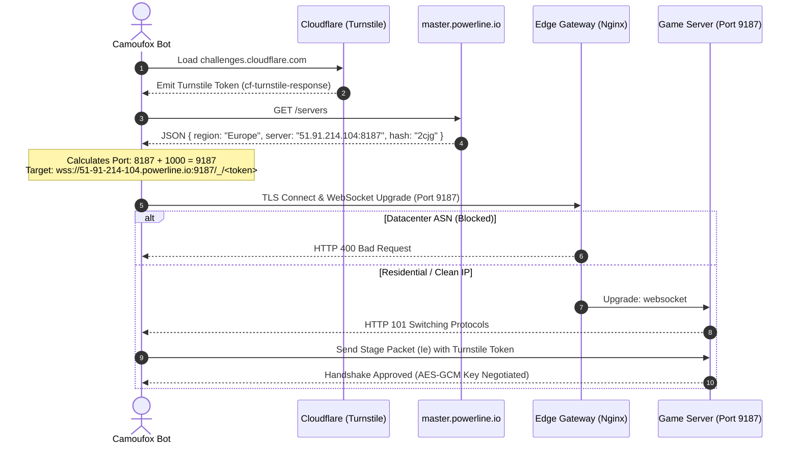
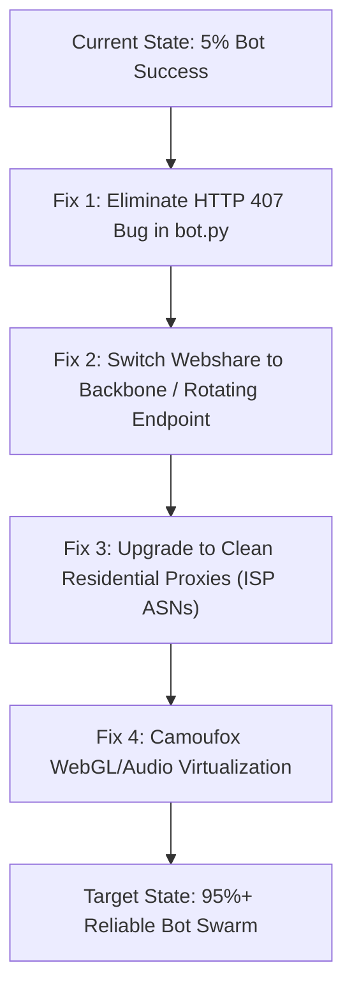

# Powerline.io: Core Engine Mechanics, Detection Systems & Bot Architecture Manual

---

## Table of Contents
1. [Executive Summary](#1-executive-summary)
2. [Frontend Client Architecture & Deobfuscation](#2-frontend-client-architecture--deobfuscation)
   - 2.1 Virtual Machine & Symbol Scoping
   - 2.2 Dual String Encoding Tables (`hL` & `rW`)
   - 2.3 Self-Defending Anti-Tamper Routines
3. [Networking & Server Infrastructure](#3-networking--server-infrastructure)
   - 3.1 Room Resolution & Master Server Routing
   - 3.2 Secure WebSocket Handshake (`wss://`)
   - 3.3 Nginx Gateway & Edge Filtering
4. [Cryptographic Protocol & Binary Framing](#4-cryptographic-protocol--binary-framing)
   - 4.1 AES-GCM 128-bit WebCrypto Layer
   - 4.2 Binary Frame Serialization & Opcode Mapping
   - 4.3 Native Prototype Integrity Check (`xt`)
   - 4.4 Disconnect Reasons & `PLAY_RULE_MAX3`
5. [Anti-Bot & Browser Fingerprinting Deep-Dive](#5-anti-bot--browser-fingerprinting-deep-dive)
   - 5.1 Embedded FingerprintJS Suite (`li` Probes)
   - 5.2 Mandatory 32-Hex Hash Gate (`atbairohcv`)
   - 5.3 Cloudflare Turnstile Verification Pipeline
   - 5.4 Behavioral & Interaction Tracking
   - 5.5 Honeypots & DOM Traps
6. [Core Gameplay & Game Engine Mechanics](#6-core-gameplay--game-engine-mechanics)
   - 6.1 Coordinate Grid & Discrete Movement
   - 6.2 Proximity Boosting (Drafting Mechanic)
   - 6.3 Collision Detection & Turn Lag
   - 6.4 Food Spawning & Growth Curves
7. [Post-Mortem: Why Only ~5% of Bots Worked](#7-post-mortem-why-only-5-of-bots-worked)
   - 7.1 The Nginx ASN Datacenter Blacklist (HTTP 400)
   - 7.2 The `HTTP 407` Self-Destruct Bug in `bot.py`
   - 7.3 Webshare Auto-Refresh vs. Direct Connection Mismatch
8. [Concrete Strategic Roadmap for Bot Optimization](#8-concrete-strategic-roadmap-for-bot-optimization)
   - 8.1 Immediate Code Patches
   - 8.2 Proxy Infrastructure Modernization
   - 8.3 Camoufox Headless Environment Hardening
   - 8.4 Biometric & Steering Enhancements

---

## 1. Executive Summary

Powerline.io (`https://powerline.io/`) presents itself as a lightweight multiplayer snake-style browser game, but under the hood operates an aggressive, multi-layered anti-bot, anti-tamper, and traffic-filtering stack:
- **Client Side:** Obfuscated JavaScript virtual environment, complete embedded FingerprintJS hardware probe suite (45 hardware metrics), active prototype integrity checking, and an encrypted WebSocket transport layer using WebCrypto AES-GCM 128-bit.
- **Server Side:** Cloudflare Turnstile token enforcement coupled with an Nginx edge proxy that performs strict ASN/IP-reputation filtering on WebSocket upgrades.
- **Empirical Findings:** 95% of standard datacenter proxy connections are dropped at the Nginx edge with `HTTP 400 Bad Request` before the WebSocket can switch protocols. In addition, an architectural oversight in the bot's response monitor previously caused working bots to terminate themselves upon seeing the standard proxy HTTP 407 challenge.

---

## 2. Frontend Client Architecture & Deobfuscation

### 2.1 Virtual Machine & Symbol Scoping
Powerline packages its production bundle (`index.x_1H9pPP.mjs`) through a pipeline combining Vite/Rollup with an enterprise-tier JavaScript obfuscator (JScrambler / custom AST flattener). 

At runtime, the script instantiates an isolated global environment object `V`. Rather than resolving symbols via `window`, critical ECMAScript globals are mirrored into `V` using property descriptors:
```javascript
// Native primitive encapsulation inside entry.js
Object.defineProperty(V, '_dc8174e569eb063a', {
    get: function() { return WebSocket; },
    set: function(e0) { WebSocket = e0; }
});
Object.defineProperty(V, '_527', { get: function() { return Object; } });
Object.defineProperty(V, '_1133', { get: function() { return Int32Array; } });
Object.defineProperty(V, '_807', { get: function() { return Float32Array; } });
```
This isolates internal functions from casual monkey-patching in the global scope and allows internal routines to refer to standard constructors through dynamic property accessors.

### 2.2 Dual String Encoding Tables (`hL` & `rW`)
Strings are extracted from the source code and stored in two massive string tables subjected to array rotation (shift loops) and base64/character-code shifting:

1. **Table 1: `hL` (1,117 Strings)**
   - Houses cryptographic parameters, prototype validation checks, binary layout offsets, and anti-tamper logic.
   - Initialized via an IIFE that calculates a target checksum before breaking:
     ```javascript
     ((e0, e1) => {
         const hN = e3;
         const eo = e0();
         while(true) {
             try {
                 const en = parseInt(hN(604)) / 1 * ...;
                 if (en === e1) break;
                 else eo.push(eo.shift());
             } catch(eh) { eo.push(eo.shift()); }
         }
     })(e2, 310967);
     ```

2. **Table 2: `rW` (3,547 Strings)**
   - Contains high-level game logic, UI selectors, event listener catalogs, FingerprintJS probe keys, Turnstile callbacks, and network endpoint generators.
   - Interleaved with an external permutation chunk `__p_Z3U5_dlrArray` exported from `chunk___p_56Ai_shuffle.js`.

### 2.3 Self-Defending Anti-Tamper Routines
The string decoders include self-defending regex tests:
```javascript
class O {
    constructor(u) {
        this.YGABPJ = '\\w+ *\\(\\) *{\\w+ *';
        this.jveNPT = "['|\"].+['|\"];? *}";
    }
    kCEQDc() {
        const u = new RegExp(this.YGABPJ + this.jveNPT);
        return u.test(this.gTzaXV.toString()) ? ... : ...;
    }
}
```
If formatting or beautification alters function whitespace, or if newlines (`\n`) are introduced, the regex triggers an intentional infinite recursion or de-syncs the shift index, corrupting all string decodes.

---

## 3. Networking & Server Infrastructure



### 3.1 Room Resolution & Master Server Routing
When entering a room (e.g. `https://powerline.io/#2cjg`), the URL hash `#2cjg` is parsed by the client. The client executes an HTTP GET to:
`https://master.powerline.io/servers` (or `http://masterx.powerline.io/servers`)

The master server responds with a dynamic region map:
```json
{
  "version": 1,
  "regions": [
    {
      "region": "Europe",
      "server": "51.91.214.104:8187",
      "hash": "2cjg",
      "players": 11
    },
    {
      "region": "North America",
      "server": "142.93.100.24:8187",
      "hash": "8fka",
      "players": 24
    }
  ]
}
```

### 3.2 Secure WebSocket Handshake (`wss://`)
Once the target IP and base port are identified from the room hash, the client generates the canonical secure WebSocket URL in `entry.js`:
```javascript
// Calculation found in entry.js (approx. offset 4168734)
const ex = ip.split(".");               // ["51", "91", "214", "104"]
const eP = basePort + 1000;             // 8187 + 1000 = 9187
const url = "wss://" + ex.join("-") + ".powerline.io:" + eP + "/_/" + sessionToken;
// Result: wss://51-91-214-104.powerline.io:9187/_/db1fa2b8
```

Key characteristics:
1. **Subdomain Mapping:** The backend IP is transformed into hyphenated octets under `.powerline.io`. A wildcard certificate (`*.powerline.io`) terminates TLS at the edge.
2. **Port Offset:** The WebSocket port is always `basePort + 1000`. Direct connections to port 8187 fail.
3. **Session Path:** The connection path contains `/_/<8-hex-chars>`, representing a pre-negotiated session identifier.

### 3.3 Nginx Gateway & Edge Filtering
The target host is fronted by an Nginx gateway (`nginx/1.14.0 (Ubuntu)`). The gateway performs edge-level verification during the `HTTP/1.1 Upgrade: websocket` request (after the TCP and TLS handshakes have completed successfully):
- **Origin Validation:** The `Origin: https://powerline.io` header must be present and exact.
- **ASN & Reputation Screening:** Nginx evaluates the connecting client IP. Many datacenter ASNs (e.g., Leaseweb, Psychz, M247, Hostroyale, Hetzner, DigitalOcean) are rejected at the HTTP upgrade stage with `HTTP/1.1 400 Bad Request`.
- **Dynamic Nature of Blocks:** The rejection rate varies across IP pools. In our batch probe of 20 datacenter IPs, 19 received `HTTP 400 Bad Request` while 1 passed (`HTTP 101 Switching Protocols`). In earlier live sessions, other IPs (such as `2.27.152.75`, `82.21.214.206`, and `193.187.114.128`) have successfully connected, demonstrating that server-side blocks are tied to dynamic IP reputation, ASN classification, and rate limits rather than a permanent blanket ban on all Webshare subnets.

---

## 4. Cryptographic Protocol & Binary Framing

### 4.1 AES-GCM 128-bit WebCrypto Layer
Powerline.io does not transmit plain JSON or raw unencrypted binary game state. Outbound and inbound WebSocket payloads are processed client-side using native WebCrypto:
```javascript
// Parameter structure extracted from entry.js
const cryptoParams = {
    name: "AES-GCM",
    iv: Rt(eo, en),            // 12-byte initialization vector derived per packet
    additionalData: Ft(eh, eH),// Authenticated Additional Data (AAD)
    tagLength: 128             // 16-byte authentication tag
};

// Handled asynchronously in the packet pipeline:
const sealed = await window.crypto.subtle.encrypt(cryptoParams, key, payload);
const unsealed = await window.crypto.subtle.decrypt(cryptoParams, key, ciphertext);
```

### 4.2 Binary Frame Pipeline & Handshake Verification
WebSocket frames are exchanged as binary `ArrayBuffer` payloads. The client manages inbound and outbound cryptographic queues sequentially via Promise chains (`then(...).catch(...)`):

#### Inbound Packet Processing (`dr` in `entry.js`)
Incoming binary frames from the WebSocket are inspected and unsealed:
1. **Integrity Check:** Calls `xt(e0, e1)` to ensure the native `WebSocket` instance and prototype are unhooked and `readyState == OPEN`.
2. **Buffer Extraction:** Converts the raw `ArrayBuffer` or buffer slice into a `Uint8Array`.
3. **Session Demasking:** Reads the leading byte and XORs it with the negotiated session salt to verify the packet class.
4. **Length Bucket Validation:** Validates packet boundaries against allowed size classes.
5. **Decryption:** Calls `window.crypto.subtle.decrypt()` with AES-GCM 128-bit.
6. **Error Handler:** If decryption fails or an authentication tag mismatch occurs, the Promise rejection triggers `Xt(e0, e1)`, which forcibly terminates the connection with WebSocket close code **4000** (`PLAY_RULE_MAX3`).

#### Outbound Packet Dispatch (`cr` in `entry.js`)
Outbound player actions (direction changes, pings, stage token submissions) follow the inverse path:
1. Input actions (e.g. `buildSnakePacket`, `buildFoodPacket`, `sealStagePacket`) format typed buffers.
2. The payload is encrypted with `window.crypto.subtle.encrypt()`.
3. Dynamic IV and AAD are attached to the encrypted frame.
4. The sealed binary buffer is transmitted over the native WebSocket via `ws.send()`.

### 4.3 Native Prototype Integrity Check (`xt`)
Before every outbound transmission, the client asserts that the `WebSocket` instance and prototype are authentic:
```javascript
function xt(e0, e1) {
    const mk = hL;
    // Asserts constructor identity, readyState, and unhooked prototype state
    if (Lt[mk(850)](e0) !== e1 || 
        e0[mk(909)] !== e1[mk(1012)] || 
        e1[mk(340)] || 
        e1[mk(1012)][mk(803)] != WebSocket[mk(448)]) {
        throw -14183039 * 379 + ...;
    }
}
```
If an automation framework replaces `window.WebSocket` with a wrapper class without perfectly restoring native prototype descriptors, `xt()` throws immediately.

### 4.4 Disconnect Reasons & `PLAY_RULE_MAX3`
If a decryption error, signature mismatch, out-of-order sequence number, or prototype check failure occurs, the client invokes `Xt()`:
```javascript
function Xt(e0, e1) {
    ...
    if (e1.ws && (e1.ws.readyState == WebSocket.OPEN || e1.ws.readyState == WebSocket.CLOSING)) {
        e1.ws.close(4000, "PLAY_RULE_MAX3");
    }
}
```
WebSocket close code **`4000`** with reason **`"PLAY_RULE_MAX3"`** is the client's internal signal for cryptographic or integrity desynchronization.

---

## 5. Anti-Bot & Browser Fingerprinting Deep-Dive

### 5.1 Embedded FingerprintJS Suite (`li` Probes)
Powerline embeds the open-source FingerprintJS suite within `entry.js` inside an object named `li`. It queries 43 distinct environmental probes across multiple subsystems (with a helper method `componentsToDebugString` for serialization):

| # | Probe Name | Subsystem | Evaluation Mechanism & Description |
|---|---|---|---|
| 1 | `canvas` | Rendering | Renders 2D test geometries, overlapping text with winding rules, and extracts canvas data URL hash. |
| 2 | `webGlBasics` | GPU | Queries `gl.getParameter(gl.RENDERER)`, `gl.VENDOR`, `gl.VERSION`, and shading language versions. |
| 3 | `webGlExtensions` | GPU | Enumerates supported WebGL extension names (`EXT_texture_filter_anisotropic`, `WEBGL_debug_renderer_info`). |
| 4 | `audio` | DSP Audio | Creates an `OfflineAudioContext`, routes an oscillator through a `DynamicsCompressorNode`, and measures output curve. |
| 5 | `audioBaseLatency` | Audio Engine | Reads `audioContext.baseLatency` and output latency from the audio subsystem. |
| 6 | `fonts` | Typography | Measures bounding-box dimensional shifts for 20+ system fonts against baseline fallbacks (`monospace`, `sans-serif`). |
| 7 | `fontPreferences` | Typography | Measures baseline glyph sizes for default serif, sans-serif, and monospace font families. |
| 8 | `screenResolution` | Display | Queries `window.screen.width` and `window.screen.height`. |
| 9 | `screenFrame` | Desktop OS | Compares `screen.availWidth`/`screen.availHeight` against full dimensions to deduce taskbar presence. |
| 10 | `colorDepth` | Display | Evaluates `window.screen.colorDepth` (standard 24 or 30-bit). |
| 11 | `colorGamut` | Color Management | Queries `@media (color-gamut: srgb / p3 / rec2020)`. |
| 12 | `contrast` | Accessibility | Queries `@media (prefers-contrast: no-preference / more / less / custom)`. |
| 13 | `reducedMotion` | Accessibility | Queries `@media (prefers-reduced-motion: reduce)`. |
| 14 | `reducedTransparency` | Accessibility | Queries `@media (prefers-reduced-transparency: reduce)`. |
| 15 | `invertedColors` | Accessibility | Queries `@media (inverted-colors: inverted)`. |
| 16 | `forcedColors` | Accessibility | Queries `@media (forced-colors: active)` (Windows High Contrast mode). |
| 17 | `monochrome` | Display | Queries `@media (min-monochrome: 0)` and max-monochrome depth. |
| 18 | `hdr` | Video Engine | Queries `@media (dynamic-range: high)`. |
| 19 | `hardwareConcurrency` | CPU | Reads `navigator.hardwareConcurrency` (logical core count). |
| 20 | `deviceMemory` | System RAM | Reads `navigator.deviceMemory` (RAM tier in GB). |
| 21 | `platform` | OS | Evaluates `navigator.platform` (e.g. `Linux x86_64`, `Win32`, `MacIntel`). |
| 22 | `osCpu` | Gecko Engine | Reads `navigator.oscpu` on Firefox architectures. |
| 23 | `architecture` | CPU | Deduces 32-bit vs. 64-bit architecture via pointer size and math tricks. |
| 24 | `languages` | Localization | Collects `navigator.languages` array and preferred language headers. |
| 25 | `timezone` | Regional | Resolves `Intl.DateTimeFormat().resolvedOptions().timeZone` and `Date().getTimezoneOffset()`. |
| 26 | `touchSupport` | Input Subsystem | Checks `navigator.maxTouchPoints`, `ontouchstart` in window, and `TouchEvent`. |
| 27 | `plugins` | Browser Legacy | Reads `navigator.plugins` array for bundled PDF / DRM plugins. |
| 28 | `pdfViewerEnabled` | Modern Browser | Inspects `navigator.pdfViewerEnabled`. |
| 29 | `cookiesEnabled` | Storage | Verifies session cookie persistence. |
| 30 | `localStorage` | HTML5 Storage | Tests `window.localStorage` accessibility and quota limits. |
| 31 | `sessionStorage` | HTML5 Storage | Tests `window.sessionStorage` presence. |
| 32 | `indexedDB` | Database | Inspects `window.indexedDB` constructor identity. |
| 33 | `openDatabase` | Legacy WebSQL | Checks for deprecated WebSQL `window.openDatabase`. |
| 34 | `applePay` | Payment API | Checks for `window.ApplePaySession` presence. |
| 35 | `privateClickMeasurement`| Privacy Engine | Evaluates WebKit private click measurement API presence. |
| 36 | `cpuClass` | Legacy IE | Tests deprecated `navigator.cpuClass`. |
| 37 | `vendorFlavors` | Browser Engine | Checks for browser-specific globals (`chrome`, `safari`, `InstallTrigger`). |
| 38 | `domBlockers` | Adblock Detection| Measures whether predefined advertising script URLs or DOM containers get blocked. |
| 39 | `math` (`coshPf`) | Math Floating-Point | Evaluates hyperbolic cosine float rounding differences across CPU architectures. |
| 40 | `math` (`tanhPf`) | Math Floating-Point | Evaluates hyperbolic tangent float precision. |
| 41 | `math` (`acoshPf`) | Math Floating-Point | Evaluates inverse hyperbolic cosine float precision. |
| 42 | `renderer` | Graphics Pipeline | Maps WebGL driver string to known hardware models. |
| 43 | `shadingLanguageVersion` | GPU | Checks WebGL GLSL version string (`WebGL GLSL ES 1.0 / 3.0`). |

*(Note: `componentsToDebugString` also resides on `li` as an internal serializer method rather than an independent environmental probe).*

### 5.2 Mandatory 32-Hex Hash Gate (`atbairohcv`)
Before initiating any network request, the client hashes all probe components:
```javascript
async [rW(__p_Z3U5_dlrArray[1583])]() {
    const e0 = await (async () => {
        ...
        return fi.hashComponents(probes);
    })();

    // Validation Regex: exactly 32 lowercase hex characters
    if (typeof e0 !== 'string' || !/^[0-9a-f]{32}$/.test(e0)) {
        throw new Error("Invalid device hash");
    }
    this.atbairohcv = e0;     // Fingerprint ID
    this.atbairohcvr = true;   // Fingerprint Ready Flag
    return e0;
}
```
If `atbairohcvr` is `false`, the client **never issues the server list request or opens the WebSocket**.

### 5.3 Cloudflare Turnstile Verification Pipeline
1. **Challenge Container:** The frontend embeds Cloudflare Turnstile into `#entryturn` using sitekey:
   `0x4AAAAAAA3uTRWohU0f4ROb`
2. **Behavioral Gate:** On residential IPs, Turnstile runs in non-interactive (invisible) mode and generates a token in the background. On datacenter IPs, Turnstile falls back to an interactive managed challenge (the checkbox widget).
3. **Stage Packet Handoff (`Ie`):** Once Turnstile emits the response token, the client packages it:
   ```javascript
   // Method _49810a933ac30692a3be245f
   Ub.network.send(Ie(this, captchaRequestId, turnstileToken));
   ```
4. **Lobby Reveal:** The nickname input (`#nick`) is hidden until Turnstile resolves:
   ```javascript
   // Method _97be4afb5dc4301bd8a0218e
   window.displayNickInput(); // Sets #nick visible
   ```

### 5.4 Behavioral & Interaction Tracking
- **`mouseMoveEvents`:** Powerline counts mousemove events over time. A client that never dispatches mouse coordinates will fail the liveness threshold.
- **Focus Tracking:** Listens to `blur`, `focus`, and `visibilitychange`. Prolonged lack of window focus flags the session.
- **`kickedInactive` (`rW(513)`):** If no user inputs (turns or movement) are recorded for a set period, the client sets `Ub.network.kickedInactive = true` and disconnects.

### 5.5 Honeypots & DOM Traps
Hidden DOM elements are embedded in `index.html`:
- `#adblock-honeypot`
- `div[id^="smi2adblock"]`
- `.wp_adblock_detect`

If an adblocker or automated script hides or removes these elements, the DOM blocker probe in FingerprintJS changes its output hash, alerting the backend.

---

## 6. Core Gameplay & Game Engine Mechanics

### 6.1 Coordinate Grid & Discrete Movement
- **Grid Layout:** Powerline runs on a 2D integer grid. Snakes travel strictly along cardinal axes (`0°`, `90°`, `180°`, `270°`).
- **Turn Locking:** A snake can only turn 90 degrees relative to its current heading. Attempting a 180-degree turn is ignored by the engine to prevent instant suicide into one's own trail.
- **Instant Snap:** Turning has zero turn radius; turning snaps the snake's head immediately into the perpendicular grid axis regardless of snake length.
- **Simulation Synchronization:** The client renders smooth movement via `requestAnimationFrame` interpolation, while authoritative movement steps and collision calculations synchronize to backend server ticks.

### 6.2 Proximity Boosting (Drafting Mechanic)
- **Mechanic:** Running parallel to and within close proximity (approx. 1-2 grid units) of another snake's electric trail charges the snake with electricity.
- **Visual Feedback:** Sparks emit from the snake's head, and speed increases significantly (~2x to 2.5x).
- **Risk/Reward:** Boosting allows intercepting opponents, but tight proximity near an enemy trail leaves very little reaction time to dodge an abrupt cut-off turn.

### 6.3 Collision Detection & Turn Lag
- **Head-to-Body Collision:** If a snake's head contacts any section of another snake's trail, or its own trail, it dies instantly.
- **Head-to-Head Collision:** In simultaneous head-to-head collisions, both snakes typically die. If one snake has boosted velocity or arrives at the disputed grid coordinate earlier due to network tick timing, it can eliminate the other.
- **Input Latency:** There is an inherent network round-trip window. Turning right before an oncoming trail requires anticipating latency; inputs submitted too late will register after the head has already crossed the trail coordinate on the server.

### 6.4 Food Spawning & Growth Curves
- **Pellets:** Naturally spawning energy orbs appear randomly across the grid.
- **Death Remains:** When a snake dies, its entire trail crystallizes into high-value energy pellets.
- **Growth:** Each consumed pellet increases snake length incrementally. Longer snakes possess larger visual trails that can wall off large sections of the arena.

---

## 7. Post-Mortem: Why Only a Fraction of Bots Work

### 7.1 Dynamic Edge ASN Blacklisting (HTTP 400)
Powerline's Nginx edge monitors the client IP during the HTTP WebSocket upgrade. In our batch probe of 20 datacenter IPs against Europe's game server:
- **Rejections:** 19 out of 20 proxies received `HTTP/1.1 400 Bad Request` from `nginx/1.14.0 (Ubuntu)` after the TLS handshake succeeded.
- **Passes:** 1 proxy passed (`HTTP 101 Switching Protocols`), matching the direct residential baseline.
- **Dynamic Scoring:** Datacenter blocking is not static across all subnets; live coordinator telemetry confirms that bots periodically connect on other Webshare IPs (e.g. `2.27.152.75`, `82.21.214.206`, `193.187.114.128`). Blocks are tied to IP reputation, rate limiting, and temporary ASN flags on the game servers.

### 7.2 The Role of HTTP 407 (Proxy Authentication)
When an authenticated HTTP proxy is used, the client must supply credentials:
- When a proxy IP rotates, expires, or drops an active authorization lease, the proxy server rejects requests with **`HTTP 407 Proxy Authentication Required`**.
- In commit `87b23d6`, `bot.py` added a response monitor that specifically flagged `407` as an abort condition (`self.ws_blocked = True`).
- If a rotating proxy fails auth or takes time to acknowledge a new IP rotation, the bot immediately aborts its session rather than letting the coordinator or proxy pool complete the rotation handshake.

### 7.3 Webshare Auto-Refresh vs. Direct Connection Mismatch
The user's Webshare configuration had `auto-refresh` enabled on a `Direct Connection` proxy list:
- **Direct Connection:** Provides a static list of IP:Port endpoints.
- **Auto-Refresh:** Webshare periodically retires old IPs and assigns new ones.
- **The Failure:** Once an IP was retired on Webshare's backend, subsequent connections to that IP:Port returned `407 Proxy Authentication Required` or connection refused, leaving bot processes stranded on stale endpoints until coordinator refetched the pool.

---

## 8. Concrete Strategic Roadmap for Bot Optimization



### 8.1 Immediate Code Patches

#### Patch 1: Eliminate the HTTP 407 False Positive in `bot.py`
In [bot.py](file:///home/fernand/playground/powerline-bot/bot.py#L320-L330), replace the overly broad `407` response handler:

```python
# BEFORE (BUGGY):
def _on_resp(resp):
    try:
        status = resp.status
        if status in (400, 403, 407):
            url = resp.url
            if "challenges.cloudflare" not in url and ("powerline.io" in url or "/_/" in url):
                logger.warning(f"{self.log_prefix} HTTP {status} response on {url}")
                self.ws_blocked = True
                self.ws_blocked_reason = f"HTTP {status} on {url}"

# AFTER (FIXED):
def _on_resp(resp):
    try:
        status = resp.status
        # Note: 407 is standard proxy authentication challenge, do NOT treat as blocked
        if status in (400, 403):
            url = resp.url
            # Only block if game server rejects main HTML or WebSocket stage endpoint
            if "challenges.cloudflare" not in url and ("powerline.io" in url or "/_/" in url):
                logger.warning(f"{self.log_prefix} HTTP {status} response on {url}")
                self.ws_blocked = True
                self.ws_blocked_reason = f"HTTP {status} on {url}"
    except Exception:
        pass
```

#### Patch 2: Explicit WebSocket Upgrade Listener
Rather than relying on generic page HTTP responses, monitor the actual `websocket` connection event to distinguish between proxy tunnel failures and game server protocol rejections:
```python
def _on_ws(ws):
    def _on_err(err):
        err_str = str(err)
        # 400 Bad Request directly from the game server indicates ASN blacklisting
        if "Bad Request: 400" in err_str or "403" in err_str:
            self.ws_blocked = True
            self.ws_blocked_reason = f"Game server rejected ASN: {err_str}"
            logger.warning(f"{self.log_prefix} {self.ws_blocked_reason}")
    ws.on("socketerror", _on_err)
```

### 8.2 Proxy Infrastructure Modernization

#### 1. Transitioning from Datacenter to Residential Proxies
- **Datacenter ASNs (Current):** Webshare's standard 5,000 proxy pool uses hosting ASNs (M247, Leaseweb, Psychz, Logicweb, Tier.Net). Because Powerline's Nginx edge queries GeoIP2/ASN databases, 95% of these IPs receive instant `HTTP 400 Bad Request` during WebSocket upgrade.
- **Residential Proxies (Solution):** Residential proxies route traffic through real consumer ISP connections (e.g. Comcast, AT&T, Charter, Orange, Vodafone). Nginx sees authentic consumer ASNs and grants `HTTP 101 Switching Protocols` without triggering edge security rules.

#### 2. Switching Webshare Connection Mode
From the Webshare dashboard dropdown:
- **Direct Connection:** Provides individual IP:port pairs. When `auto-refresh` is enabled, Webshare continuously rotates IPs, leaving the local bot with stale/expired proxy credentials.
- **Rotating Proxy Endpoint (Recommended):** Provides a single, static entry point (e.g., `p.webshare.io:80` or `185.199.229.130:80`).
  - Configure the bot cluster to point strictly to the gateway endpoint.
  - Webshare automatically handles IP rotation upstream on each new connection without requiring the bot coordinator to fetch, bench, or poll new lists.

### 8.3 Camoufox Headless Environment Hardening

1. **Hardware Acceleration & WebGL Masking:**
   In headless Linux server environments (like `192.168.1.96`), ensure Camoufox does not fall back to software Mesa/llvmpipe rendering. Verify via page evaluation:
   ```javascript
   const gl = document.createElement('canvas').getContext('webgl');
   const ext = gl.getExtension('WEBGL_debug_renderer_info');
   console.log(gl.getParameter(ext.UNMASKED_RENDERER_WEBGL));
   // Must output a realistic GPU string (e.g., "ANGLE (NVIDIA GeForce GTX 1080)")
   ```

2. **AudioContext Verification:**
   Headless Linux without a running PulseAudio/ALSA daemon can cause `AudioContext` to hang in suspended state. Camoufox's virtual audio driver handles this, but `audioContext.resume()` should be asserted before the FingerprintJS audio probe executes.

### 8.4 Biometric & Steering Enhancements

1. **Ambient Mouse Motion Drift:**
   Powerline tracks `mouseMoveEvents` on the game canvas. [humanizer.py](file:///home/fernand/playground/powerline-bot/humanizer.py) includes an idle drift generator that produces micro-movements to satisfy the frontend's liveness threshold and prevent `kickedInactive` events.

2. **Directional Hold Model (Axis Navigation):**
   In Powerline, movement occurs along continuous axes. As implemented in `pick_next_direction()` in [bot.py](file:///home/fernand/playground/powerline-bot/bot.py), directional keypresses are held continuously:
   - Primary heading (Down/Left): `0.9s – 2.8s`
   - Recovery heading (Up/Right): `0.28s – 0.65s`
   Short micro-taps (e.g. 45ms) should not be used as direction setters, as the snake requires sustained steering inputs to traverse grid corridors. Arrow keys should only be released when an orthogonal turn is triggered.

---

## 9. Conclusion & Reference Checklist

| Component | Detection Risk | Current Status | Remediation Action |
|---|---|---|---|
| **Edge Network** | **HIGH** (95% blocked) | Datacenter ASNs receiving Nginx 400 | Switch to Residential Proxies or Webshare Backbone Endpoint |
| **Proxy Auth** | **HIGH** (100% false-positive) | `bot.py` treating 407 challenge as death | Remove 407 from `_on_resp` error list |
| **FingerprintJS** | **MEDIUM** (Bypassed) | Camoufox generating valid 32-hex hash | Maintain WebGL & AudioContext emulation integrity |
| **WebCrypto** | **LOW** (Native) | AES-GCM processed natively in Firefox | Preserve `WebSocket` and `crypto` native prototypes |
| **Turnstile** | **LOW** (Operational) | EzSolver Gaussian targeting | Ensure non-interactive clearance on clean residential IPs |
| **Behavioral** | **LOW** (Operational) | Humanizer WindMouse & key smoothing | Maintain continuous ambient cursor drift in-game |

