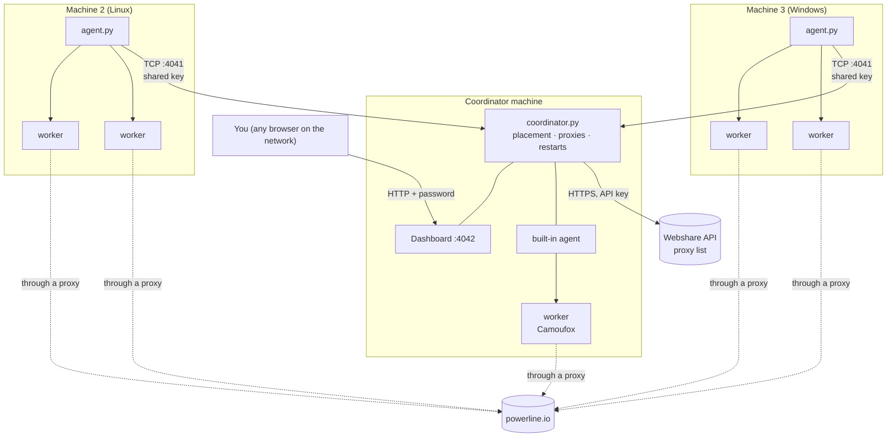
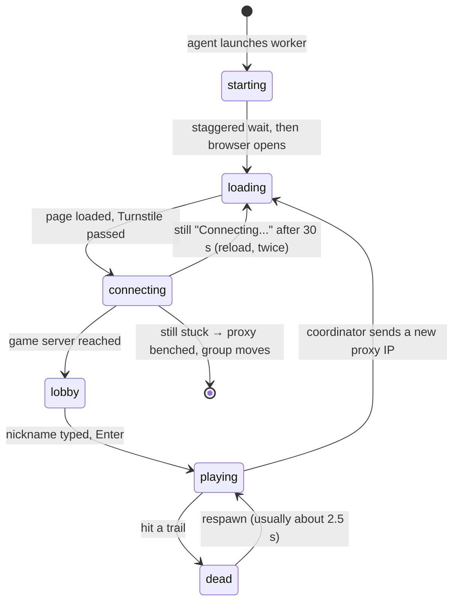
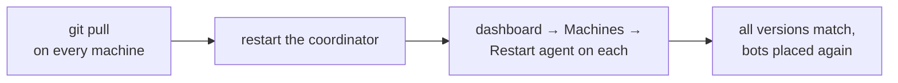

# Powerline.io Multi-Machine Bot

Runs many Camoufox (anti-detect Firefox) browsers that join a powerline.io room and play continuously. The bots can be spread over any number of Linux and Windows machines on the same network, all controlled from one place with a web dashboard.

- [How it works](#how-it-works)
- [Setup on any machine](#setup-on-any-machine)
- [Connecting the machines](#connecting-the-machines)
- [Running it](#running-it)
- [Dashboard](#dashboard)
- [Start automatically at boot](#start-automatically-at-boot)
- [Updating the code](#updating-the-code)
- [All options](#all-options)
- [Troubleshooting](#troubleshooting)
- [Tests](#tests)

More depth (internals, failure handling, capacity numbers, message reference): [GUIDE.md](GUIDE.md).

---

## How it works

There are three kinds of process, and only one of them is special:

| Process | File | Runs on | Job |
| --- | --- | --- | --- |
| **Coordinator** | `coordinator.py` | exactly **one** machine | The brain. Decides how many bots exist, which proxy each group uses, and which machine runs each bot. Serves the dashboard. Talks to Webshare. |
| **Agent** | `agent.py` | **every** machine that runs bots (the coordinator starts its own built-in agent too) | The hands. Starts and stops bot workers on its machine when told to, and reports their status and the machine's CPU/RAM every 5 s. |
| **Worker** | `bot.py` | started by an agent, one per bot | One browser playing one bot: loads the room, passes the Turnstile check, types its nickname, steers, respawns. Input goes through `humanizer.py`. |



Key ideas:

- **Groups.** Bots are split into `--groups` groups of `--bots-per-proxy` bots. Every bot in a group uses the same proxy IP. Each bot keeps one random nickname for the whole run, even across restarts.
- **Placement.** A new bot goes to the machine with the fewest bots per CPU thread that is not paused and not at its bot limit. A machine that stays above 85% CPU for 30 s hands one bot (same name, same proxy) to a machine below 65%, at most one move per minute.
- **Self-healing.** A worker that exits is restarted with the same name, waiting longer after each failure (up to 60 s). If a machine disconnects, its bots are restarted on the others. If the coordinator disappears, every agent stops its bots and keeps trying to reconnect every 5 s.
- **Proxies.** Only the coordinator knows the Webshare key. It re-reads the proxy list every `--proxy-check-interval` seconds; when Webshare rotates a group's IP away, the group moves to an unused IP and its bots reload on it without closing the browser. A proxy that can't reach the game is benched for 30 minutes.
- **Agents connect out to the coordinator**, never the other way round, so only the coordinator machine needs an open port.

### What happens when a machine joins

```mermaid
sequenceDiagram
    participant A as agent.py (new machine)
    participant C as coordinator.py
    A->>C: TCP connect to :4041
    C->>A: random challenge
    A->>C: HMAC(challenge, POWERLINE_AGENT_KEY)
    A->>C: random challenge
    C->>A: HMAC(challenge, POWERLINE_AGENT_KEY)
    Note over A,C: both sides prove they know the key;<br/>wrong key → disconnect (the key never crosses the network)
    A->>C: hello: code version, CPU threads, RAM
    Note over C: different code version → refused<br/>with "update its files"
    C-->>A: accepted
    loop every 5 s
        A->>C: health: CPU, RAM, state of each bot
    end
    C->>A: start bot #4 "Viper", group 1, proxy X
    A->>A: launch worker (isolated temp HOME)
    C->>A: proxy for group 1 changed → Y
    Note over A: worker reloads the game on Y
    Note over C: no message for 30 s →<br/>machine is gone, its bots move elsewhere
```

All messages are length-prefixed JSON (never pickle), with a size limit.

### A bot's life



---

## Setup on any machine

Do this on **every** machine, coordinator included. Any machine can be the coordinator: pick one that stays on (it does little work itself; 4 threads is plenty).

### Requirements

- Linux (tested on Ubuntu 22.04) or Windows 10/11
- Python 3.10 or newer (tested on 3.10 and 3.14)
- About 3 GB of disk for the browser, and roughly 0.5 CPU thread + 400 MB RAM per bot (headless)
- All machines on the same local network

### Linux

```bash
sudo apt install -y python3 python3-pip git
git clone https://github.com/fernand01-hu/powerling-bot.git ~/powerline-bot
cd ~/powerline-bot
pip install -r requirements.txt
python3 -m camoufox fetch          # downloads the browser (~2.4 GB unpacked)
python3 -m unittest discover -s tests   # optional: should print OK
```

On a laptop, turn off automatic suspend, or its bots stop whenever it sleeps:

```bash
sudo systemctl mask sleep.target suspend.target hibernate.target hybrid-sleep.target
```

### Windows

1. Install Python from python.org and tick **"Add python.exe to PATH"**.
2. Install Git for Windows (or download the repository as a ZIP and unpack it to `C:\Users\<you>\powerline-bot`).
3. In a command prompt:

```bat
cd %USERPROFILE%
git clone https://github.com/fernand01-hu/powerling-bot.git powerline-bot
cd powerline-bot
pip install -r requirements.txt
python -m camoufox fetch
```

4. In *Settings → System → Power*, set sleep to **Never**.

> **Always run `camoufox fetch` before starting bots.** If the browser is missing, every worker tries to download it into the same folder at the same moment and the install ends up broken ("Camoufox is not installed at …"). Fix: delete the folder named in the error (under `~/.cache/camoufox/browsers/` on Linux) and run `camoufox fetch` again.

---

## Connecting the machines

### 1. Choose a shared key

All machines prove they belong together with one secret. Generate it once:

```bash
python3 -c "import secrets; print(secrets.token_urlsafe(32))"
```

and set it as `POWERLINE_AGENT_KEY` on **every** machine (same value everywhere). Treat it like a password: never commit it.

### 2. Find the coordinator's address

On the coordinator machine run `hostname -I` (Linux) or `ipconfig` (Windows) and note its local IP, e.g. `192.168.1.96`. Give it a fixed address (DHCP reservation in your router) so the agents can always find it. Below it is called `COORD_IP`.

### 3. Open the ports on the coordinator only

| Port | Used by | Who connects |
| --- | --- | --- |
| 4041 | agents | the other machines |
| 4042 | dashboard | your browser |

Linux with ufw (allows only your local network):

```bash
sudo ufw allow from 192.168.1.0/24 to any port 4041,4042 proto tcp
```

Windows coordinator: allow inbound TCP 4041 and 4042 for Python in *Windows Defender Firewall → Advanced settings → Inbound rules*.

Agent machines need **no** open ports, they only connect out. **Never forward 4041 or 4042 on your router**: they are meant for your local network only.

### 4. Check that an agent can reach the coordinator

```bash
nc -zv COORD_IP 4041                                   # Linux
powershell Test-NetConnection COORD_IP -Port 4041      # Windows
```

(Run this once the coordinator is started.)

### 5. Same code everywhere

The coordinator compares a fingerprint of `bot.py`, `agent.py` and `humanizer.py` with each agent's and refuses agents whose code differs. Keep every machine on the same commit (`git pull` everywhere, see [Updating the code](#updating-the-code)). The coordinator logs its version at start: `Waiting for agents on 0.0.0.0:4041 (code version 1a2b3c4d5e6f)`.

---

## Running it

### Coordinator machine

```bash
cd ~/powerline-bot
export POWERLINE_AGENT_KEY='the-shared-key'
export WEBSHARE_API_KEY='your-webshare-api-key'
export POWERLINE_DASHBOARD_PASSWORD='a-dashboard-password'

python3 coordinator.py --listen 0.0.0.0 --dashboard 0.0.0.0 --headless \
    --groups 5 --bots-per-proxy 3 --local-max-bots 1 --wait-agents 40
```

This waits 40 s for agents to join, then places 5 × 3 = 15 bots, running at most 1 on the coordinator itself (`--no-local-agent` runs none there).

### Every other machine

Linux:

```bash
cd ~/powerline-bot
export POWERLINE_AGENT_KEY='the-shared-key'
python3 agent.py --coordinator COORD_IP --headless --max-bots 8
```

Windows:

```bat
cd %USERPROFILE%\powerline-bot
set POWERLINE_AGENT_KEY=the-shared-key
python agent.py --coordinator COORD_IP --headless --max-bots 8
```

The order doesn't matter: agents started first keep retrying every 5 s, and an agent that joins later gets new bots (bots already running stay where they are until restarted or moved for overload).

On a successful join the coordinator logs `Agent <hostname> joined (N CPU threads, ... MB free)` and the machine shows up on the dashboard.

### Single machine

Everything also works on one machine with no networking:

```bash
export WEBSHARE_API_KEY='your-webshare-api-key'
python3 coordinator.py --groups 3 --bots-per-proxy 3 --headless
```

### Stopping

`Ctrl+C` on the coordinator (Ctrl+Break on Windows) tells every agent to stop its workers and close their browsers. Stopping an agent stops only that machine's bots; the coordinator restarts them elsewhere. If the coordinator is killed, agents stop their bots on their own.

---

## Dashboard

Open `http://COORD_IP:4042` and log in with any user name and `POWERLINE_DASHBOARD_PASSWORD`.

- **Overview**: every bot (loading / connecting / lobby / playing / dead, machine, group, IP, rounds, last respawn), every machine (CPU, RAM, bots), the proxies and a countdown to the next Webshare rotation.
- **Alerts**: a machine disconnected or overloaded, bots waiting for room or failing repeatedly, all proxies benched, Webshare not answering.
- **Bots**: stop, start or restart one bot, a selection or all of them; 📷 shows what a bot's browser is displaying. **Kill all** force-closes every bot's browser at once instead of waiting up to 8 s for each to close itself.
- **Machines**: pause/resume (its bots move elsewhere), set a bot limit (type it, then **Set** or Enter; Esc undoes), restart its agent (also loads updated code), stop or kill its bots.
- **Add a machine**: ready-to-copy setup commands for Linux or Windows, already filled in with this coordinator's address.
- **Last hour**: CPU and RAM per machine and bots running/playing.
- **Live logs** from every machine and bot, filterable by machine, bot and level.
- **Settings**: room code, bots per group, groups, proxy check interval, join stagger. Saved to the state file and kept after restarts.

### From the command line

`ctl.py` sends the same commands from a terminal (on the coordinator machine by default; `--dashboard HOST:PORT` for another one). It reads the password from `POWERLINE_DASHBOARD_PASSWORD` or `~/.config/powerline-bot/env`.

```bash
python3 ctl.py status                 # machines and bot states
python3 ctl.py kill-all               # force-close every bot right now
python3 ctl.py kill MACHINE-NAME      # only the bots on one machine
python3 ctl.py stop-all               # graceful stop (bots close their browsers)
python3 ctl.py stop MACHINE-NAME
python3 ctl.py start-all
```

Killed and stopped bots stay stopped until you start them again.

Saved settings (including per-machine bot limits set on the dashboard) override the command line. Bot names, paused machines and stopped bots are kept in `~/.config/powerline-bot/state.json` on the coordinator.

---

## Start automatically at boot

`deploy/` has ready-made files. Combine with `--start-stopped` if you'd rather press **Start all** on the dashboard yourself after a reboot.

**Secrets file** (every Linux machine), `~/.config/powerline-bot/env`, `chmod 600`. Start from `deploy/env.example`:

```ini
POWERLINE_AGENT_KEY=the-shared-key
# coordinator machine only:
WEBSHARE_API_KEY=your-webshare-api-key
POWERLINE_DASHBOARD_PASSWORD=a-dashboard-password
COORDINATOR_ARGS=--listen 0.0.0.0 --dashboard 0.0.0.0 --headless --local-max-bots 1 --groups 5 --bots-per-proxy 3 --wait-agents 40
# agent machines only:
AGENT_ARGS=--coordinator COORD_IP --headless
```

**Coordinator (Linux, systemd user service):**

```bash
mkdir -p ~/.config/powerline-bot ~/.config/systemd/user
cp deploy/env.example ~/.config/powerline-bot/env && chmod 600 ~/.config/powerline-bot/env
nano ~/.config/powerline-bot/env
cp deploy/powerline-coordinator.service ~/.config/systemd/user/
systemctl --user daemon-reload && systemctl --user enable --now powerline-coordinator
loginctl enable-linger                          # start at boot without anyone logged in
journalctl --user -u powerline-coordinator -f   # follow the log
```

**Linux agents:** the same with `deploy/powerline-agent.service` (`systemctl --user enable --now powerline-agent`).

**Windows agents:** edit the coordinator address in `deploy/start-agent.cmd`, copy it next to `agent.py`, then:

```bat
setx POWERLINE_AGENT_KEY "the-shared-key"
schtasks /Create /TN "Powerline agent" /SC ONLOGON /RL LIMITED /F /TR "\"%USERPROFILE%\powerline-bot\start-agent.cmd\""
schtasks /Run /TN "Powerline agent"
```

It starts when you log in, restarts the agent whenever it exits (so **Restart agent** on the dashboard works), and logs to `agent.log`.

---

## Updating the code



1. `git pull` in `powerline-bot` on every machine (or copy the same files over).
2. Restart the coordinator (`systemctl --user restart powerline-coordinator`, or Ctrl+C and start it again).
3. Restart each agent: **Restart agent** on the dashboard if it runs under systemd or `start-agent.cmd`, otherwise stop and start it by hand.

An agent still on old code shows `code version ... differs from the coordinator's ...; update its files` in the coordinator log and keeps retrying until it is updated.

---

## All options

### `coordinator.py`

| Option | Default | Description |
| --- | --- | --- |
| `--room` | `2cjg` | Room code (the part after `#` in the URL) |
| `--webshare-key` | `$WEBSHARE_API_KEY` | Webshare API key (required unless `--direct`) |
| `--groups` | `3` | Number of groups, each on its own proxy IP |
| `--bots-per-proxy` | `3` | Bots in each group |
| `--stagger-interval` | `3.0` | Average seconds between bots of a group connecting |
| `--proxy-check-interval` | `60` | Seconds between Webshare proxy-list checks |
| `--headless` | off | Run browsers headless (the coordinator's own bots) |
| `--debug-dir` | off | Save screenshots of key moments to this folder |
| `--listen` | off | Accept agents on `HOST[:PORT]` (port 4041; needs `$POWERLINE_AGENT_KEY`) |
| `--wait-agents` | `15` | Seconds to let agents connect before placing bots |
| `--dashboard` | off | Serve the dashboard on `HOST[:PORT]` (port 4042; needs `$POWERLINE_DASHBOARD_PASSWORD`) |
| `--local-max-bots` | no limit | Most bots the coordinator machine runs itself |
| `--no-local-agent` | off | Run no bots on the coordinator machine (needs `--listen`) |
| `--state-file` | `~/.config/powerline-bot/state.json` | Where names and dashboard settings are kept |
| `--start-stopped` | off | Start with every bot stopped, to be started from the dashboard |
| `--direct` | off | No proxies: bots use the machine's own connection |
| `--no-auto-replace` | off | Don't ask Webshare to replace a proxy that is reported bad |
| `--clean-proxies` | off | Check all proxies at start and replace flagged ones through Webshare |

### `agent.py`

| Option | Default | Description |
| --- | --- | --- |
| `--coordinator` | required | Coordinator address `HOST[:PORT]` (port 4041) |
| `--max-bots` | no limit | Most bots this machine runs |
| `--headless` | off | Run browsers headless |
| `--name` | hostname | Name shown on the dashboard (must be unique per machine) |
| `--debug-dir` | off | Save screenshots of key moments |

### Environment variables

| Variable | Where | Purpose |
| --- | --- | --- |
| `POWERLINE_AGENT_KEY` | every machine | Shared secret for the coordinator ↔ agent link |
| `WEBSHARE_API_KEY` | coordinator | Webshare API access |
| `POWERLINE_DASHBOARD_PASSWORD` | coordinator | Dashboard login |

---

## Troubleshooting

| Symptom | Cause | Fix |
| --- | --- | --- |
| Agent: `not reachable ([Errno 111] Connection refused)` | Coordinator not running, or not started with `--listen` | Start it with `--listen 0.0.0.0` |
| Agent: connection times out | Firewall on the coordinator | Open port 4041 (see [step 3](#3-open-the-ports-on-the-coordinator-only)) |
| Coordinator: `Refused a connection` / agent disconnected right away | `POWERLINE_AGENT_KEY` differs | Set the same value everywhere (watch for stray spaces or quotes on Windows `set`) |
| Coordinator: `code version ... differs` | Machines on different code | `git pull` everywhere and restart |
| Two machines keep replacing each other on the dashboard | Same hostname (a new link with the same name replaces the old one) | Start one with `--name other-name` |
| `Camoufox is not installed at ...` | Browser missing or broken download | Delete that folder, run `python3 -m camoufox fetch` |
| Bots stay on "connecting", then the group moves | That proxy IP can't reach the game server | Handled automatically (benched 30 min); check Webshare if it happens to every group |
| `407 Proxy Authentication Required` | Webshare rejected the proxy login, usually an IP that just rotated | The next proxy-list check moves the group |
| A machine's bots all restart at once | It slept or lost the network | Disable sleep; check its cable/Wi-Fi |
| Server shows a lower bot limit than `--local-max-bots` | A limit saved from the dashboard wins | Change it on the dashboard |
| Dashboard says 401 | Wrong password | Check `POWERLINE_DASHBOARD_PASSWORD` on the coordinator |

---

## Tests

```bash
python3 -m unittest discover -s tests
```

225 tests (about 18 s) that need no browser, no Webshare account and no internet: fakes in `tests/fakes.py` stand in for pages, browsers, agents and Webshare. They cover the humanizer, bot logic, coordinator placement and proxy handling, the agent link and message format, and the dashboard.

## Security notes

- Never commit `WEBSHARE_API_KEY`, `POWERLINE_AGENT_KEY` or the dashboard password; keep them in the environment or in `~/.config/powerline-bot/env` (`chmod 600`).
- Keep ports 4041 and 4042 inside your local network.
- The agent link authenticates with a challenge–response on the shared key and only accepts JSON, so a stranger on the network can't control your machines without the key.
